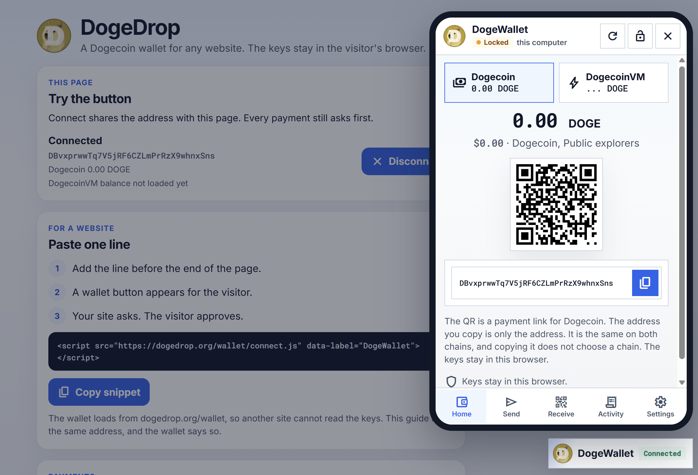

# DogeDrop



DogeDrop is a Dogecoin and DogecoinVM wallet made of HTML, CSS, and JavaScript. Keys are created and kept in the visitor's browser. The page that embeds the wallet never receives the recovery phrase or a private key.

The code has not been audited. Be careful, and test with a small amount only. The wallet and the demo both show that warning until the visitor dismisses it.

It is meant for ordinary payments on Dogecoin's own chain: a balance, an address, and a send button. The same person can open it from a chat site, a tip jar, or the wallet's own page.

## Why the keys stay on the visitor's computer

Browsers do not let one website read another website's storage. The wallet is therefore hosted on its own address (GitHub Pages is enough). Other sites include one script, which opens that wallet in a frame. The frame's storage holds the encrypted wallet. The surrounding page only receives the address, the balance, and a transaction id after the visitor approves.

On the wallet's own address the wallet is first-party, so it is remembered. Inside another site, browsers keep embedded storage separate until the visitor clicks **Use my wallet here**. After that, the same wallet is available. Opening the wallet in its own tab once is sometimes required by the browser before an embedded page may reuse it.

What is stored:

- The 12-word recovery phrase, encrypted with the visitor's password (PBKDF2 and AES-GCM). It is not sent to the website.
- The account public key, so the wallet can show addresses and look up coins while locked.
- Which sites the visitor has connected.

A new wallet cannot be saved until the visitor re-enters three of the 12 words. Change from a payment goes to the next address on the standard Dogecoin path `m/44'/3'/0'/1/0`, `…/1`, and so on. Receiving addresses use `m/44'/3'/0'/0/0` and the next unused ones.

## Host the wallet on GitHub Pages

The wallet is static files. Node.js is not required to open it or to put it on a website. Node is only for someone changing the signing source in `src/chain.mjs`.

1. Push this repository to [qlpqlp/dogedrop](https://github.com/qlpqlp/dogedrop).
2. Open the repository, then **Settings**, then **Pages**.
3. Under **Build and deployment**, choose **Deploy from a branch**. Set the branch you pushed and the folder **/docs**. Save.
4. Wait until GitHub shows the site. [dogedrop.org](https://dogedrop.org) is that site. The guide is the front page. The wallet program is [dogedrop.org/wallet](https://dogedrop.org/wallet/).

Pages publishes only `docs/`. The files at the repository root are the working copy. The copy that the site serves is `docs/wallet/`, including `connect.js`. Pushing does not turn Pages on. The folder must be **/docs** once. After that, a push updates the site.

## Add it to any website

On the site that should offer Dogecoin, paste this before `</body>`:

```html
<script src="https://dogedrop.org/wallet/connect.js" data-label="DogeWallet"></script>
```

`docs/index.html` shows the same line, with a button that copies it, and a tip that uses it. Another website loads the wallet from dogedrop.org/wallet, so that website cannot read the keys. The guide itself is on dogedrop.org, so the wallet warns that this page can reach the wallet.

That script adds a small button: the Dogecoin logo, the word `DogeWallet`, and **Connected** or **Not connected**. `data-label` changes the word. Clicking it opens the visitor's wallet. If the site is not allowed yet, the wallet asks before it shares the address. Each payment asks again. Add `data-button="false"` to hide the button and call `window.doge.open()` yourself.

GitHub Pages hosts the wallet program only. The keys are created and kept in the visitor's browser, encrypted with their password. GitHub never receives them. Loading `connect.js` from that address keeps the browser storage separate from the other website, so that website cannot read the recovery phrase or the encrypted wallet. This is the setup to use for a public page.

Hosting your own copy of these files is allowed. Point `src` at your copy of `connect.js`. The wallet and the page then share an address, so the page's scripts can read the wallet storage. The wallet shows a warning in that case.

### Connect and ask for a payment

`window.doge` is available after the script loads. Wait for `doge#initialized` if your own script is above `connect.js`.

```html
<button id="pay" type="button">Pay 1.5 DOGE</button>
<script src="https://dogedrop.org/wallet/connect.js" data-label="DogeWallet"></script>
<script>
  document.getElementById('pay').addEventListener('click', async () => {
    const linked = await doge.connect();
    const sent = await doge.requestTransaction({
      recipientAddress: 'D...',
      dogeAmount: '1.5'
    });
    console.log(linked.address, sent.txid);
  });
</script>
```

`dogeAmount` is DOGE, such as `"1.5"`. `connect()` returns `{ approved, address, publicKey, balance }`. `balance` is the Dogecoin amount in koinu (1 DOGE = 100,000,000 koinu). `balanceVm` is the DogecoinVM amount in koinu. `requestTransaction` returns `{ approved, txid }`.

The same key creates the same `D...` address on Dogecoin and on DogecoinVM. The coins are separate. A payment link chooses the chain, following [DIP 21](https://github.com/MetalBlockchain/dogecoin-vm/blob/dogecoin/docs/dip-0021.md):

```text
dogecoin:D...?amount=1.5
dogecoinvm:D...?amount=1.5
```

`amount` is DOGE, with at most 8 decimal places. `label` and `message` are shown to the sender and are not put on the chain. A bare address does not choose a chain. The sender picks Dogecoin or DogecoinVM before the payment is signed. A `dogecoinvm:` link is never paid on Dogecoin, and a `dogecoin:` link is never paid on DogecoinVM.

`recipientAddress` may be either link. If `dogeAmount` is also set, that amount is used.

DogecoinVM lookups and broadcasts use `https://vm.dogedrop.org` unless the visitor picks a custom address in Settings. That address only forwards the public DogecoinVM API. [metaldoge.com](https://metaldoge.com/) explains the chain, and it does not allow a browser page to call it directly. A Dogecoin confirmation usually takes 1 to 10 minutes. A DogecoinVM payment is final in about a fifth of a second. The recovery phrase stays in the browser. The explorer sees addresses that are looked up, and it never receives keys.

| Call | What the visitor sees |
| --- | --- |
| `connect()` | Asks to share the receive address |
| `getConnectionStatus()` | Whether this site was already allowed |
| `getBalance()` | `{ balance, balanceDoge }`. `balance` is koinu |
| `getAddress()` | The current receive address, after this site is connected |
| `requestTransaction({ recipientAddress, dogeAmount })` | A confirm screen, then the signed payment |
| `requestSignedMessage({ message })` | A signature, without spending |
| `disconnect()` | Forgets that this site was allowed |
| `open()` | Opens the wallet panel |

These calls match the shape sites used with MyDogeMask (`window.doge`).

`docs/index.html` is the dogedrop.org page: the snippet, and a tip you can try. Serve the project and open `/docs/`, or open that file directly in Chrome. The page loads `docs/wallet/connect.js`. Connect and the DogeWallet button open the wallet, and Close hides it. Looking up a balance still needs the internet. Open `/docs/wallet/` for the wallet by itself. On the live site that address is `https://dogedrop.org/wallet/`.

## Look up coins and send the payment

The default needs no account. [Dogechain](https://dogechain.com/developers/api) supplies the price, recent fees, and payment history. [Blockchair](https://blockchair.com/api/docs) supplies the unspent coins and accepts the signed transaction. BlockCypher is the backup if Blockchair does not answer. Before a public explorer payment is signed, the wallet checks each coin against a second explorer. Nothing is broadcast if they disagree.

## Host your own DogecoinVM bridge

GitHub Pages is a static site. It cannot call [metaldoge.com](https://metaldoge.com/) from the visitor's browser, because that explorer does not send a CORS header. A small Node program in `metaldoge/` fixes that for one website. It listens on `127.0.0.1` and forwards only `/api/info`, `/api/address/D...`, `/api/tx/...`, and a signed payment. It refuses every other path, limits how often one address can call it, and answers only `https://dogedrop.org`, `https://www.dogedrop.org`, and `https://qlpqlp.github.io`.

Hosting your own copy is recommended. Whoever runs the bridge can see the addresses being looked up. Running it yourself, or pointing Settings at your own DogecoinVM node, keeps that list off someone else's server. A serverless page still needs some host that adds the CORS header. The keys are never part of these requests.

On the server:

```bash
cd metaldoge
TRUST_PROXY=1 node server.mjs
```

On Windows, run `set TRUST_PROXY=1` and then `node server.mjs`. Node 18 or newer is enough. There are no packages to install. `TRUST_PROXY=1` counts visitors separately when nginx is the only program that can reach the port. Put TLS in front of it for `vm.dogedrop.org`:

```nginx
server {
  server_name vm.dogedrop.org;
  location / {
    proxy_pass http://127.0.0.1:8787;
    proxy_set_header Host $host;
    proxy_set_header X-Forwarded-For $remote_addr;
  }
}
```

To allow another website, start it with `ALLOWED_ORIGINS=https://dogedrop.org,https://example.com`. In the wallet, choose Custom and enter `https://vm.dogedrop.org`, or your own address.

In **Settings** the visitor can switch to:

- **BlockCypher** or **SoChain** (SoChain needs an API key; broadcasting stays on a public explorer unless a node is chosen)
- **Dogecoin Core** JSON-RPC: `scantxoutset` to find coins and `sendrawtransaction` to broadcast. The private key is never sent to the node.
- **DogeGo** with the same JSON-RPC methods. See [dogego.org](https://dogego.org/).
- **MemeTracker**: your node's address. Coins come from `GET /getUTXOs` and watched payments from `GET /getTransactions`, the [libdogecoin SPV REST API](https://lib.dogecoin.org/docs/rest). The wallet never downloads the node wallet file. Sending posts the signed transaction to `/sendtx`. If that node does not accept it, choose Public explorers, Dogecoin Core, or DogeGo for sending.

A Core or DogeGo node does not answer a website unless it sends CORS headers and is reached over HTTPS. An `https://` page cannot call `http://127.0.0.1`. A small reverse proxy in front of the node is enough:

```nginx
add_header Access-Control-Allow-Origin "https://dogedrop.org" always;
add_header Access-Control-Allow-Headers "authorization, content-type" always;
add_header Access-Control-Allow-Methods "POST, OPTIONS" always;
if ($request_method = OPTIONS) { return 204; }
proxy_pass http://127.0.0.1:22555;
```

A node has no address index, so it can list coins that are still unspent, not a full history of empty addresses. The public explorers can do that history, which matters when restoring a phrase.

## Run it locally

Open `index.html` in a browser, or upload the folder to any static host. No install step is required.

Developers who change `src/chain.mjs` rebuild the browser bundle with Node:

```bash
npm install
npm test
npm run build
```

`npm run build` refreshes `js/doge-chain.js`. The page uses that built file.

The readable signing code is `src/chain.mjs`. It uses audited libraries (`@scure/bip39`, `@scure/bip32`, `@scure/btc-signer`, `@noble/secp256k1`) and checks addresses against a separate hash160 implementation in the tests.

The folder `1.0.90_0` is an unpacked copy of the Doge Soft extension, kept here only as a reference for how an injected `window` wallet behaves. This project does not extend that extension.

## Limits

This does not replace a browser extension. A site has to include `connect.js`. Payments are normal Dogecoin P2PKH transfers, not Doginals or tokens. The visitor who loses the 12 words loses the coins. The password only locks the copy stored in that browser.
